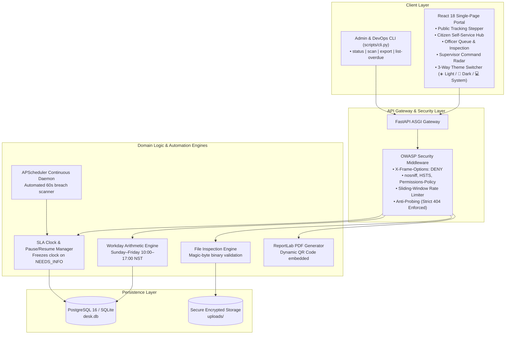

# 🏛️ Citizen Service Desk — Public Office Workflow & SLA Platform

[](https://www.python.org/)
[](https://fastapi.tiangolo.com/)
[](https://react.dev/)
[](https://tailwindcss.com/)
[](https://pytest.org/)
[](#-enterprise-security-fortress)
[](.github/workflows/ci.yml)
[](Dockerfile)

> A modern, production-grade public service office counter & workflow platform designed for high-accountability governance. Citizens track applications transparently and book appointments, officers process cases through an immutable state machine, and supervisors receive automated statutory delay escalation alerts when service-level deadlines are at risk.

---

## 🌟 Why This Exists (The Problem Solved)

Public service agencies frequently suffer from:
1. **The "Black Hole" Experience**: Citizens submit applications and have zero visibility into processing stages, creating frustration and endless phone inquiries.
2. **Arbitrary Delays & Missed Deadlines**: Statutory timeframes are poorly tracked, with no accountability when cases linger on an officer's desk.
3. **Flawed SLA Accounting**: Traditional clocks penalize the government even when waiting on citizens to submit missing documents.
4. **Counter Congestion**: Citizens arrive without appointments, overwhelming front-line staff.

**Citizen Service Desk** provides a verifiable, automated, and tamper-evident digital workflow platform that solves these challenges with mathematical precision.

---

## 📐 System Architecture



---

## 🚀 Key Feature Highlights

### 1. 🇳🇵 Nepal National Time, Dual AD/BS Calendar & Hamro Patro
- **Live Nepal Clock (NPT / UTC+5:45)**: Real-time ticking seconds clock calibrated for Nepal Standard Time.
- **Dual Calendar Conversion (AD & BS)**: Full mathematical conversion between Gregorian (`19 October 2026 AD`) and Bikram Sambat (`२ कात्तिक २०८३, सोमबार BS`) in both Devanagari script and English.
- **Hamro Patro Integration**: Direct one-click shortcut to the official Hamro Patro calendar (`hamropatro.com/calendar`).
- **Statutory Working Hours**: Implements standard government business days (Sunday to Friday, 10:00 AM – 5:00 PM; offices closed Saturdays).

### 2. ☀️ 🌙 💻 3-Way Theme Switcher (Light, Dark, and System Mode)
- **Light Mode**: Clean, high-contrast civic white and slate aesthetics.
- **Dark Mode**: Rich midnight navy (`bg-navy-950`), glowing micro-borders, and frosted glass cards (`glass-panel`).
- **System Mode**: Automatically synchronizes with the host operating system's dark/light preference.
- **Persistent**: Remembers user preference across sessions via `localStorage`.

### 3. 🛡️ Enterprise Security Fortress (Zero-Risk Architecture)
- **OWASP Response Headers**: Enforces `X-Frame-Options: DENY`, `X-Content-Type-Options: nosniff`, `Strict-Transport-Security`, and `Permissions-Policy`.
- **Anti-Probing 404 Defense**: Unauthorized attempts to inspect other citizens' requests, documents, or audit logs strictly return `404 Not Found` (never `403 Forbidden`) to eliminate ID harvesting attacks.
- **Binary Magic-Byte Inspection**: File uploads are checked against true raw binary signatures (`%PDF-`, `\x89PNG`, `\xff\xd8\xff`). Disguised executables or scripts are rejected at the gateway.
- **Anti-Timing Attack Protection**: Login verifies credentials using constant-time dummy hashes, preventing user enumeration through microsecond timing differences.
- **Sliding-Window Rate Limiting**: Throttles sensitive endpoints (`/auth/login`, `/auth/register`, `/track/{ref}`) returning standard `429 Too Many Requests` with `Retry-After`.

### 4. 📜 Tamper-Evident QR Code PDF Completion Certificates
- Upon reaching `COMPLETED`, a formal digital certificate is generated on-the-fly using `reportlab`.
- Embeds official seals, reference IDs, resolution dates, and an **interactive QR code** linking directly to the public verification endpoint (`/track/{reference}`).

### 5. ⏱️ Mathematical SLA Clock & State Machine
- **Pause & Resume**: When an officer marks a request as `NEEDS_INFO`, the SLA clock automatically freezes. When the citizen uploads required documents and resumes review, the due date is extended by the exact working seconds spent waiting.
- **Delay Escalation Radar**: Automatic alerts categorized by urgency:
  - `WARN_50`: 50% of statutory timeframe elapsed.
  - `BREACH_100`: Statutory deadline passed.
  - `CRITICAL_200`: Overdue by more than 200% of target duration.

### 6. 💻 Admin & DevOps CLI Tool (`scripts/cli.py`)
Terminal interface for sysadmins and automated cron jobs:
- `python -m scripts.cli status`: Live system health, compliance %, and officer workloads.
- `python -m scripts.cli scan`: Immediate SLA breach scan across all active files.
- `python -m scripts.cli export --format [csv|json]`: Exports full compliance reports.
- `python -m scripts.cli list-overdue`: Formatted ASCII table of delayed requests.

---

## ⚡ Quick Start Guide

### Prerequisites
- Python 3.12+
- Node.js 20+ *(only if building frontend locally)*

### Local Setup (Recommended for Development)

```bash
# 1. Clone repository
git clone https://github.com/itz-aaditya/citizen-service-desk.git
cd citizen-service-desk

# 2. Set up Python virtual environment
python -m venv .venv
# Windows:
.venv\Scripts\activate
# Linux/macOS:
source .venv/bin/activate

# 3. Install dependencies
pip install -r requirements-dev.txt

# 4. Seed demo data (creates accounts, offices, services, sample delays)
python -m scripts.seed_demo

# 5. Build the React frontend
cd frontend
npm install
npm run build
cd ..

# 6. Start the server
uvicorn app.main:app --host 127.0.0.1 --port 8000 --reload
```

Open **`http://127.0.0.1:8000`** in your browser to experience the portal.

---

### Docker Deployment (Single-Command Production Run)

```bash
# Builds frontend in Stage 1, packages FastAPI in Stage 2, starts PostgreSQL 16 & web server
docker compose up --build
```

---

## 🔑 Demo Accounts & Interactive Tour

| Persona | Email | Password | Primary Capabilities |
|---|---|---|---|
| **Citizen** | `citizen1@example.org` | `demo-password-1` | Submit requests, upload documents, book counter slots, download QR certificates |
| **Officer** | `officer1@example.org` | `demo-password-1` | Work assigned queue, inspect citizen documents, verify/reject files, update status |
| **Supervisor** | `supervisor@example.org` | `demo-password-1` | Executive analytics dashboard, delay escalation radar, assign officers, run manual scans |
| **Public** | *(No login required)* | — | Track reference milestones without exposing citizen personal identifiable information (PII) |

> 💡 **Tip**: Use the **1-Click Demo Switcher** (`👤 Citizen`, `👮 Officer`, `👔 Supervisor`) at the top of the portal to switch personas instantly with zero typing!

---

## 🧪 Automated Testing & Quality Verification

All 49 tests pass with strict coverage and linting gates:

```bash
# Run backend test suite with coverage report
pytest

# Run Ruff linter and formatting checks
ruff check .
ruff format --check .

# Test the Admin CLI commands
python -m scripts.cli status
python -m scripts.cli list-overdue
python -m scripts.cli export --format csv
```

### Coverage Report
```text
Name                                   Stmts   Miss  Cover
----------------------------------------------------------
app\config.py                             11      0   100%
app\database.py                           16      4    75%
app\main.py                               83     11    87%
app\models.py                            113      0   100%
app\routers\*.py                         236     11    95%
app\schemas.py                           190      0   100%
app\security.py                           82     19    77%
app\services\*.py                        618     47    92%
----------------------------------------------------------
TOTAL                                   1445     92    94%
Required test coverage of 90% reached. Total coverage: 93.63%
======================= 49 passed in 27.75s =======================
```

---

## 🗺️ API Reference Tour

Interactive Swagger documentation is available at **`http://127.0.0.1:8000/docs`**.

| Method & Route | Access Level | Description |
|---|---|---|
| `POST /auth/register` | Public | Register new citizen account (rate-limited) |
| `POST /auth/login` | Public | Authenticate user (timing-attack protected) |
| `GET /auth/me` | Authenticated | Retrieve current user profile and role |
| `GET /services` | Public | List active government services & SLA working days |
| `GET /offices` | Public | List office locations and slot capacities |
| `GET /offices/{code}/availability` | Public | Check 30-min slot capacity for given date |
| `GET /track/{reference}` | Public | Public status stepper (zero PII exposed) |
| `POST /requests` | Citizen | Submit a new service request |
| `GET /requests` | Role-Aware | Filter requests by status/type |
| `GET /requests/{id}` | Owner / Assigned / Supervisor | Detail inspection (anti-probing 404) |
| `POST /requests/{id}/transition` | Role-Dependent | Move request along workflow state machine |
| `GET /requests/{id}/certificate` | Owner / Supervisor | Download tamper-evident completion PDF |
| `POST /requests/{id}/documents` | Owner / Assigned | Upload document (binary magic-byte verified) |
| `POST /documents/{id}/verify` | Officer / Supervisor | Mark document as VERIFIED or REJECTED |
| `POST /appointments` | Citizen | Book 30-minute office counter appointment |
| `GET /reports/delays` | Supervisor | View all active files with delay levels |
| `GET /reports/analytics` | Supervisor | View SLA compliance rate % and caseload matrix |
| `POST /alerts/scan` | Supervisor / Daemon | Execute SLA scan and trigger delay alerts |

---

## 📄 License & Attribution

Distributed under the MIT License. Built with pride for transparent, modern public administration.
